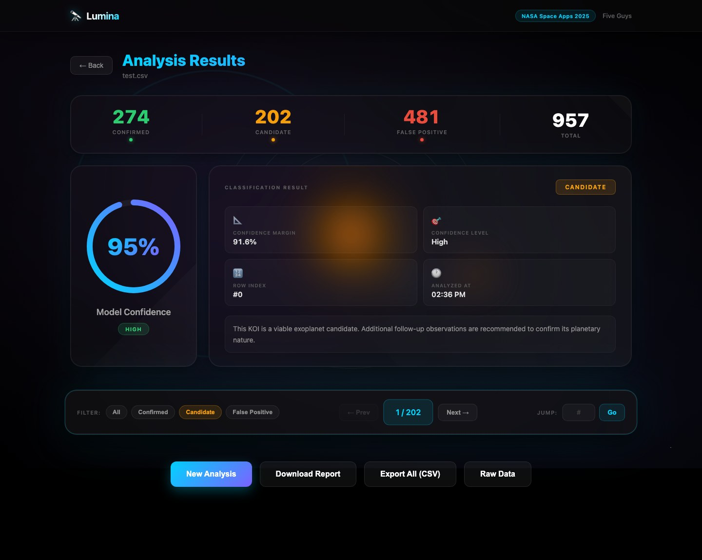

# PlanetExplorer

When a planet passes in front of its star, it can leave a small dip in the star’s brightness. Other effects can produce similar signals. For the 2025 NASA Space Apps Challenge, Team Five Guys built PlanetExplorer to explore how a model classifies signals already catalogued by the Kepler mission. The browser interface is called **Lumina**.

## How it works

### Start with Kepler’s observations

Open Lumina and select **Analyze Dataset**. It runs the classifier on a held-out set of Kepler Objects of Interest (KOIs) from the NASA Exoplanet Archive. Each row includes measurements such as how much the star dimmed during a transit, along with the archive’s existing false-positive flags.


### See how the model classified the dataset

The results dashboard counts how many rows the model labelled **Confirmed**, **Candidate**, or **False Positive**. Filter to **Candidate** to browse those predictions, or use the row controls to move through the full set.

### Look closer at a prediction

Each row shows the model’s confidence and the gap between its two highest class scores. The **High**, **Medium**, and **Low** labels use both numbers, so you can see when the top two predictions were close. Download a text report for the current row or export all predictions as a CSV.



## Quick start

Use **Python 3.11** with pip and an internet connection for the first data download. Run these commands from a terminal on macOS or Linux.

```bash
git clone https://github.com/itzadx-sudo/PlanetExplorer.git
cd PlanetExplorer
python3.11 -m venv .venv
source .venv/bin/activate
python -m pip install -r requirements.txt
python data/download.py
python model/train.py
python web.py
```

Training saves a checkpoint in `artifacts/`. The launcher loads the newest checkpoint in that folder and opens [Lumina on port 8080](http://localhost:8080). For later sessions, activate the same environment and run `python web.py` again. Press **Ctrl+C** to stop the server.

## Behind the predictions

[The data script](data/download.py) downloads the cumulative KOI table and uses a stratified 90/10 train/test split. [The training script](model/train.py) holds out part of the training data for validation, fills missing feature values with training-set medians, and scales the inputs. It trains a residual multilayer perceptron with a class-weighted loss and chooses the checkpoint based on validation macro F1.

[The Flask app](backend/app.py) serves the Lumina interface and runs inference on the test split. The model learns from Kepler’s catalogue dispositions, which are the reference labels for this project.

## License

[Apache License 2.0](LICENSE)
